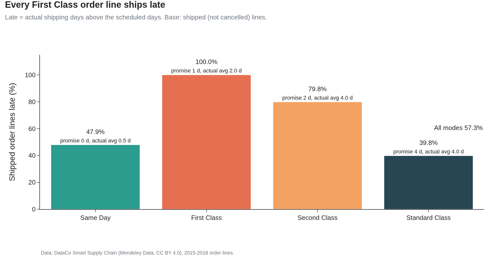
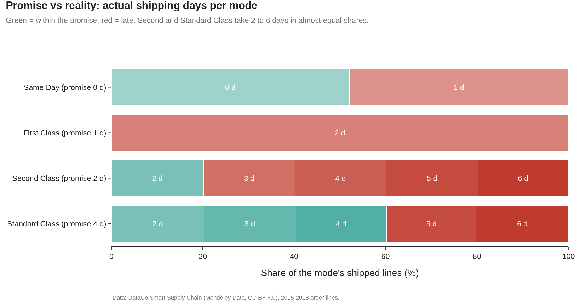
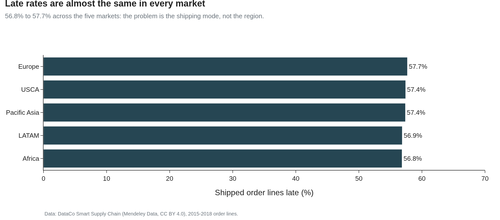
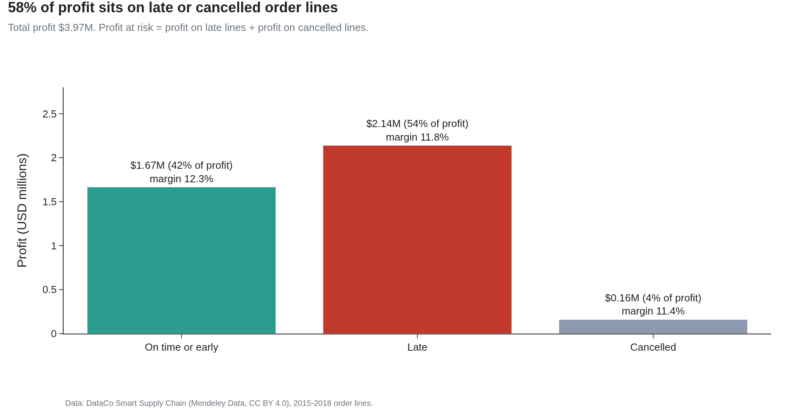
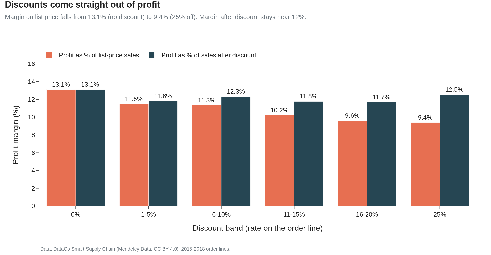
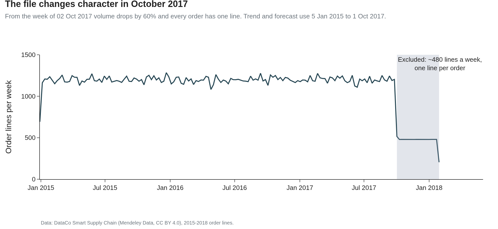
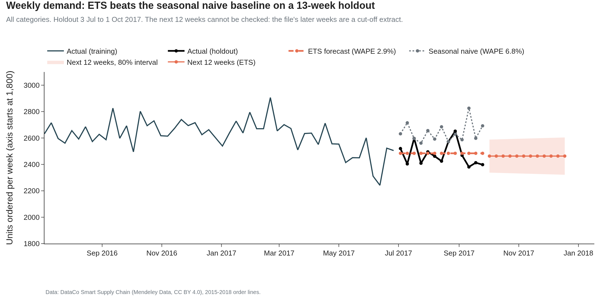
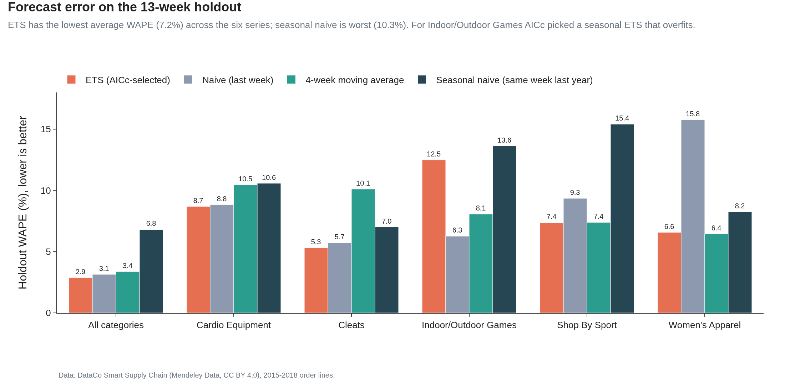
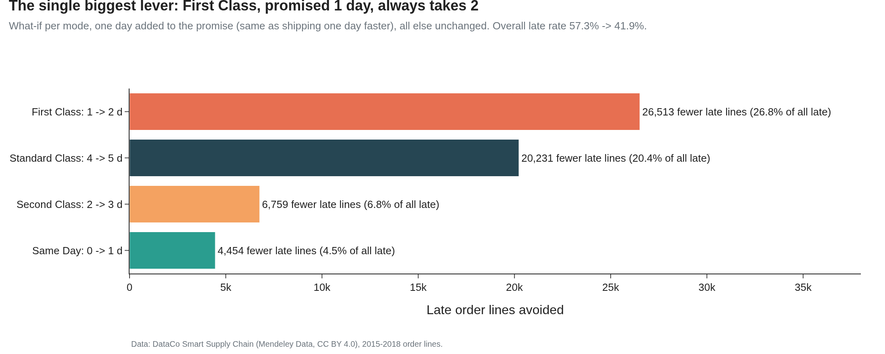
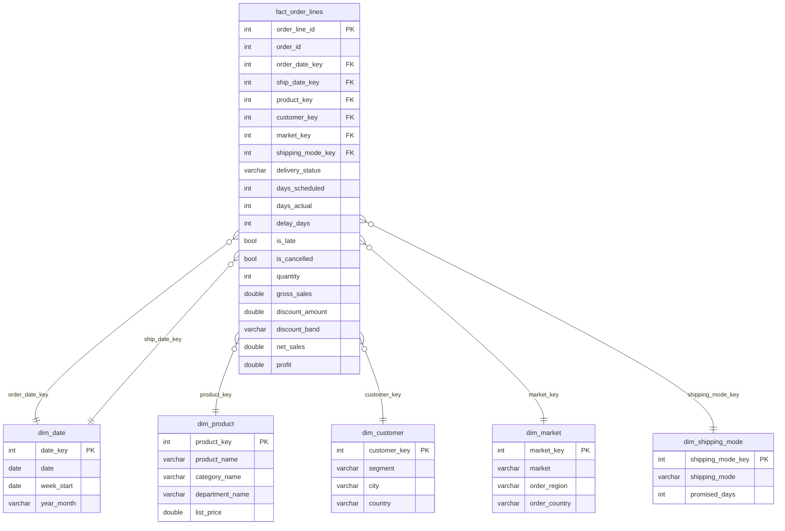

# Supply chain: why most orders are late, and a weekly demand forecast

Why are more than half of the orders in the DataCo supply chain dataset delivered late,
how much profit sits on those orders, and how well can weekly demand be forecast? This
project answers it in SQL on 180,519 order lines (65,752 orders, Jan 2015 to Jan 2018),
with a star schema in DuckDB, a forecast checked on a holdout, and a "what if" for the
one change that would cut late deliveries the most.

## Questions

1. How often are orders late, and does it depend on shipping mode, market or category?
2. How much profit is at risk on late or cancelled orders, and what do discounts do to margin?
3. How well can weekly units be forecast, compared with simple baselines?
4. Which single change would cut late deliveries the most?

## Data source

| Source | What | Period | Licence |
|---|---|---|---|
| [DataCo Smart Supply Chain for Big Data Analysis](https://data.mendeley.com/datasets/8gx2fvg2k6/5) (Mendeley Data, v5) | One row per order line: shipping mode, promised and actual shipping days, delivery status, customer, market, product, sales, discount, profit | Jan 2015 to Jan 2018 | CC BY 4.0 |

Citation: Constante, Fabian; Silva, Fernando; Pereira, António (2019), "DataCo SMART
SUPPLY CHAIN FOR BIG DATA ANALYSIS", Mendeley Data, V5, doi: 10.17632/8gx2fvg2k6.5.

The raw CSV (96 MB) is not stored in this repository. `make data` downloads it and checks
its SHA-256 and row count. The dataset is **synthetic** (see Limitations). The masked
customer email and password columns, customer names, street and zip code are dropped in
the first cleaning step and never reach the database.

## Key findings

Every number comes from a named query in [sql/findings.sql](sql/findings.sql); the
results are in [docs/findings_results.md](docs/findings_results.md).

### 1. Late deliveries

- **57.3% of shipped order lines are late** (98,977 of 172,765). By order it is the same,
  57.3%. On average the promise is 2.93 days and the actual shipping time 3.50 days; late
  lines are 1.62 days late on average.
- **The shipping mode explains almost everything.** First Class promises 1 day and
  *always* takes 2, so it is late 100% of the time. Second Class promises 2 days and takes
  2 to 6 (79.8% late). Standard Class promises 4 and also takes 2 to 6 (39.8% late), and
  because it carries 59.7% of all lines it still causes 41.4% of all late lines. Same Day:
  47.9% late.
- **Geography and product do not matter.** All five markets are between 56.8% (Africa)
  and 57.7% (Europe). The 23 regions range from 51.6% (Canada) to 60.1% (Central Africa).
  Categories with at least 1,000 lines sit between 56.9% and 59.8%.







### 2. Profit at risk and discounts

- **58.0% of profit ($2.30M of $3.97M) sits on late or cancelled lines**: $2,140,052 on
  late lines and $160,482 on cancelled ones ($85,137 of that on orders flagged as suspected
  fraud). Net sales on those lines: $19.5M.
- Late lines are not much less profitable per dollar: margin 11.83% vs 12.29% for on-time
  lines. The risk is the share of revenue that depends on a broken promise, not a lower
  margin.
- **Discounts come straight out of profit.** Profit as a share of list price falls from
  13.09% with no discount to 9.39% at 25%. The 0% and 25% bands have almost the same list
  price sales ($2.04M each), and profit is 28.2% lower in the 25% band. After the
  discount, margin stays flat (11.7% to 13.1%), so a bigger discount does not bring
  higher-margin sales.
- 18.7% of all lines lose money.





### 3. Demand forecast

- **The data changes shape in October 2017.** Up to the week of 25 Sep 2017 there are
  about 1,199 lines a week and 3 lines per order. From the week of 2 Oct 2017 it is about
  480 lines a week and almost always 1 line per order (1.01 on average). This is detected in SQL (a week below 60%
  of the trailing 12-week median with under 1.2 lines per order, `sql/04_regime.sql`) and
  the 8,392 lines after the break are left out of the forecast and of year-on-year
  comparisons.
- Demand is flat: Jan to Sep units were -1.3% in 2016 and -2.6% in 2017 year on year,
  with no clear yearly season.
- **Holdout test** (last 13 weeks, 3 Jul to 25 Sep 2017, never seen in training): an
  exponential smoothing model, ETS(A,N,N) chosen by AICc on the training weeks, misses
  total weekly units by **2.88% (WAPE)**. Baselines: last week 3.14%, 4-week moving
  average 3.38%, same week last year 6.81%.
- Over the total and the 5 largest categories (6 series), the ETS model averages 7.22%
  WAPE vs 7.64% (moving average), 8.18% (last week) and 10.28% (same week last year). It
  beats same-week-last-year in all 6. In Indoor/Outdoor Games AICc picked a seasonal ETS
  that overfit (12.49% vs 6.26% for last week), a reminder to keep the baselines.
- Next 12 weeks (all categories): about 2,463 units a week (80% interval about 2,330 to
  2,596). These weeks fall after the break, so this is what demand would be if the old
  pattern had continued; it cannot be checked against the file.







Model details: [docs/forecast.md](docs/forecast.md).

### 4. The one change that cuts late deliveries the most

Adding one day to the promise of one mode, with actual shipping times unchanged:

| Change | Late lines avoided | Share of all late lines | Overall late rate after |
|---|---|---|---|
| **First Class: 1 → 2 days** | **26,513** | **26.8%** | **41.9%** |
| Standard Class: 4 → 5 days | 20,231 | 20.4% | 45.6% |
| Second Class: 2 → 3 days | 6,759 | 6.8% | 53.4% |
| Same Day: 0 → 1 days | 4,454 | 4.5% | 54.7% |

Fixing First Class is the biggest single lever: either promise the 2 days it really takes,
or make it really ship in 1 day. Either way the late rate drops from 57.3% to 41.9%. The
full grid (every promise from 0 to 6 days for every mode) is in `mart_whatif_promise`.



## Dashboard

Tableau Public: **TODO, link added after publishing.**

The dashboard reads one Excel file, `tableau/supply_chain_late_deliveries.xlsx` (12 tidy
sheets, about 50 KB), built from the DuckDB database by `src/tableau_workbook.py`. The
tests check its numbers against `docs/findings.json`. The sheet-by-sheet build plan with
fields, colours and typed positions is in [tableau/BUILD_SPEC.md](tableau/BUILD_SPEC.md).
The same sheets are in `exports/*.csv`.

A Power BI version of the model is in `powerbi/`: the star schema tables
(`powerbi/model/`), DAX measures (on-time %, late %, profit at risk, YoY, forecast WAPE)
in [powerbi/measures.dax](powerbi/measures.dax), relationships and build steps in
[powerbi/BUILD_NOTES.md](powerbi/BUILD_NOTES.md) and the page plan in
[powerbi/layout.md](powerbi/layout.md).

## Data model

A star schema in DuckDB, one row per order line in the fact table.



SQL lives in `sql/`:

| File | Purpose |
|---|---|
| `01_staging.sql` | View over the cleaned Parquet file (Polars does the renames and drops). |
| `02_dimensions.sql` | Date, product, customer, market and shipping mode dimensions. |
| `03_fact.sql` | Fact table with late / on time / cancelled flags, delay days and discount bands. |
| `04_regime.sql` | Weekly volume with a trailing 12-week median (window) to find the October 2017 break. |
| `05_marts.sql` | Marts for charts and dashboard: rolling 4-week demand, LAG 1 / 52 week, year-to-date running totals, category ranks, monthly YoY, the what-if grid. |
| `findings.sql` | One named query per finding in this README. |

Window functions used: `ROWS BETWEEN` rolling sums and medians, `LAG` over 1, 12 and 52
periods, `RANK`, running totals with `SUM() OVER (ORDER BY ...)`, and shares with
`SUM() OVER ()`.

Definitions (late, cancelled, profit at risk, WAPE): [docs/definitions.md](docs/definitions.md).
Columns: [docs/data_dictionary.md](docs/data_dictionary.md).

## Data quality

`src/validate.py` runs 29 checks (unique keys, no orphan foreign keys, flags that add up,
delay = actual - promised, net sales = gross - discount, one shipping mode per promise,
and more) and reconciles the fact table with the raw CSV: rows, orders, sales, net sales,
profit, late and cancelled lines and units all match exactly. Results:
[docs/validation.md](docs/validation.md). The same checks run as pytest tests.

## How to reproduce

Needs Python 3.11+ and GNU make. The download is 96 MB.

```bash
make all        # everything below, in order
make setup      # virtual environment from requirements.txt
make data       # download the CSV to data/raw/ and check it
make build      # Polars cleaning + DuckDB star schema (data/supply_chain.duckdb)
make validate   # data checks and reconciliation -> docs/validation.md
make forecast   # ETS vs baselines on the 13-week holdout -> docs/forecast.md
make findings   # sql/findings.sql -> docs/findings_results.md and findings.json
make charts     # PNG charts in images/ (Plotly + Kaleido, needs Chrome)
make tableau    # tableau/supply_chain_late_deliveries.xlsx and exports/
make powerbi    # powerbi/model/
make test       # pytest (51 tests)
```

The full run takes under a minute after the download.

## Skills shown

- SQL: star schema design, window functions, data quality checks, reconciliation with the source
- Python: Polars for cleaning, DuckDB, statsmodels ETS forecasting, pytest
- Forecasting: time-based holdout, WAPE / MAPE / bias, naive and seasonal baselines, AICc model choice, handling a structural break
- Analysis: scenario (what-if) analysis, profit at risk, discount vs margin
- BI: Tableau Public dashboard spec, Power BI model with DAX measures
- Reproducibility: Makefile pipeline, checksummed download, tests

## Limitations

- **The data is synthetic**, and it shows:
  - Late rates are almost the same in every market, region, segment and category; only
    the shipping mode makes a difference.
  - First Class always ships in exactly 2 days. Second and Standard Class ship in 2 to 6
    days with almost exactly 20% of lines on each day.
  - Each of the 18 discount rates is used by 10,028 or 10,029 lines, and the line-level
    correlation between discount and margin is only -0.02.
  - Each market appears in its own block of months (for example USCA only from Apr 2016
    to Jan 2017), so market trends over time cannot be compared.
  - Country names are in Spanish ("Estados Unidos", "Alemania").
  - The structure changes from October 2017 (1 line per order, less than half the
    volume). The forecast stops before it.
- "Days for shipping (real)" is the ship date minus the order date. It measures time to
  ship, not time to deliver, so "late" here means "shipped later than promised".
- The what-if keeps actual shipping times fixed. A real change of promise could change
  which mode customers pick.
- Profit at risk is profit on late or cancelled lines. The dataset does not say how many
  late orders were refunded or how many customers were lost, so it is an exposure, not a
  loss.
- The forecast is for units per week across the whole business and 5 categories. It
  ignores prices, promotions and stock, which the data does not support.

## Licence

Code: MIT. Data: CC BY 4.0, Constante, Silva and Pereira (2019), Mendeley Data,
doi: 10.17632/8gx2fvg2k6.5.
