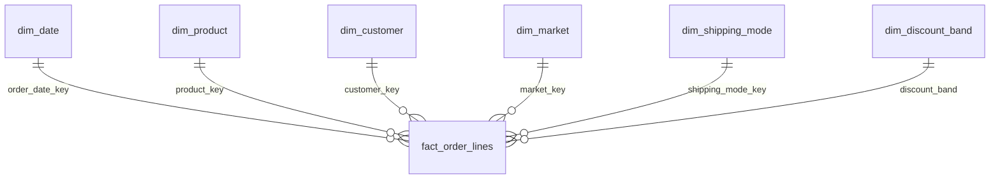

# Power BI build notes

Power BI Desktop (Windows, free) is needed; it is not part of `make all`.
Everything below uses the files in `powerbi/model/`, created by `make powerbi`.

## 1. Load the tables

Home, Get data:

| Table | File | Connector |
|---|---|---|
| fact_order_lines | `fact_order_lines.parquet` (180,519 rows) | Parquet. The CSV with the same name is also written by `make powerbi` but is not in git (28 MB). |
| dim_date | `dim_date.csv` (1,133 days, 1 Jan 2015 to 6 Feb 2018) | Text/CSV |
| dim_product | `dim_product.csv` (118 products) | Text/CSV |
| dim_customer | `dim_customer.csv` (20,652 customers; segment, city, state, country only) | Text/CSV |
| dim_market | `dim_market.csv` (167 market + region + country rows) | Text/CSV |
| dim_shipping_mode | `dim_shipping_mode.csv` (4 rows) | Text/CSV |
| dim_discount_band | `dim_discount_band.csv` (6 rows) | Text/CSV |
| forecast_weekly | `forecast_weekly.csv` (1,086 rows) | Text/CSV |
| forecast_accuracy | `forecast_accuracy.csv` (36 rows: 4 models + 2 ETS specs not selected, 6 series) | Text/CSV |
| whatif_promise | `whatif_promise.csv` (28 rows) | Text/CSV |

In Power Query check the types: `*_key` columns Whole number, `date` and
`week_start` Date, `is_*` True/False, money columns Decimal number,
`discount_rate` Decimal number. CSVs are UTF-8 with a header row.

## 2. Relationships (Model view)

All are many-to-one, single direction, from the fact to the dimension.

| From (many) | To (one) | Active |
|---|---|---|
| fact_order_lines[order_date_key] | dim_date[date_key] | yes |
| fact_order_lines[ship_date_key] | dim_date[date_key] | **no** (use `USERELATIONSHIP` if you need ship dates) |
| fact_order_lines[product_key] | dim_product[product_key] | yes |
| fact_order_lines[customer_key] | dim_customer[customer_key] | yes |
| fact_order_lines[market_key] | dim_market[market_key] | yes |
| fact_order_lines[shipping_mode_key] | dim_shipping_mode[shipping_mode_key] | yes |
| fact_order_lines[discount_band] | dim_discount_band[discount_band] | yes |
| forecast_weekly[week_date_key] | dim_date[date_key] | **no**, keep the forecast tables standalone |

`forecast_weekly`, `forecast_accuracy` and `whatif_promise` are already
aggregated. Do not relate them to the fact table; they would double count.

Then:

- dim_date: Table tools, Mark as date table, column `date`.
- Sort columns: dim_date[month_name] by dim_date[month];
  dim_shipping_mode[shipping_mode] by dim_shipping_mode[promised_days];
  dim_discount_band[discount_band] by dim_discount_band[band_order].
- Hide all `*_key` columns and the fact's `discount_band` (use the dimension's).

## 3. Measures

Create an empty `_Measures` table (Enter data, then hide its column) and paste
the measures from `measures.dax` one by one. Set the display folders and
formats written in the comments.

Check against the README after loading (no filters):

| Measure | Expected |
|---|---|
| Order Lines | 180,519 |
| Orders | 65,752 |
| Late % | 57.3% |
| Profit | $3,966,903 |
| Profit at Risk | $2,300,534 (58.0%) |
| ETS WAPE % (series = All categories) | 2.88% |
| Seasonal Naive WAPE % (series = All categories) | 6.81% |

If Late % shows 54.8%, the measure is dividing by all lines instead of
shipped lines.

## 4. Pages

See `layout.md`.

## 5. Save

Save as `powerbi/supply_chain_late_deliveries.pbix` and take a screenshot of
each page into `images/powerbi_*.png` for the README. The .pbix is a binary
file; it can be committed if it stays well under 50 MB (it should, with the
Parquet fact table).
